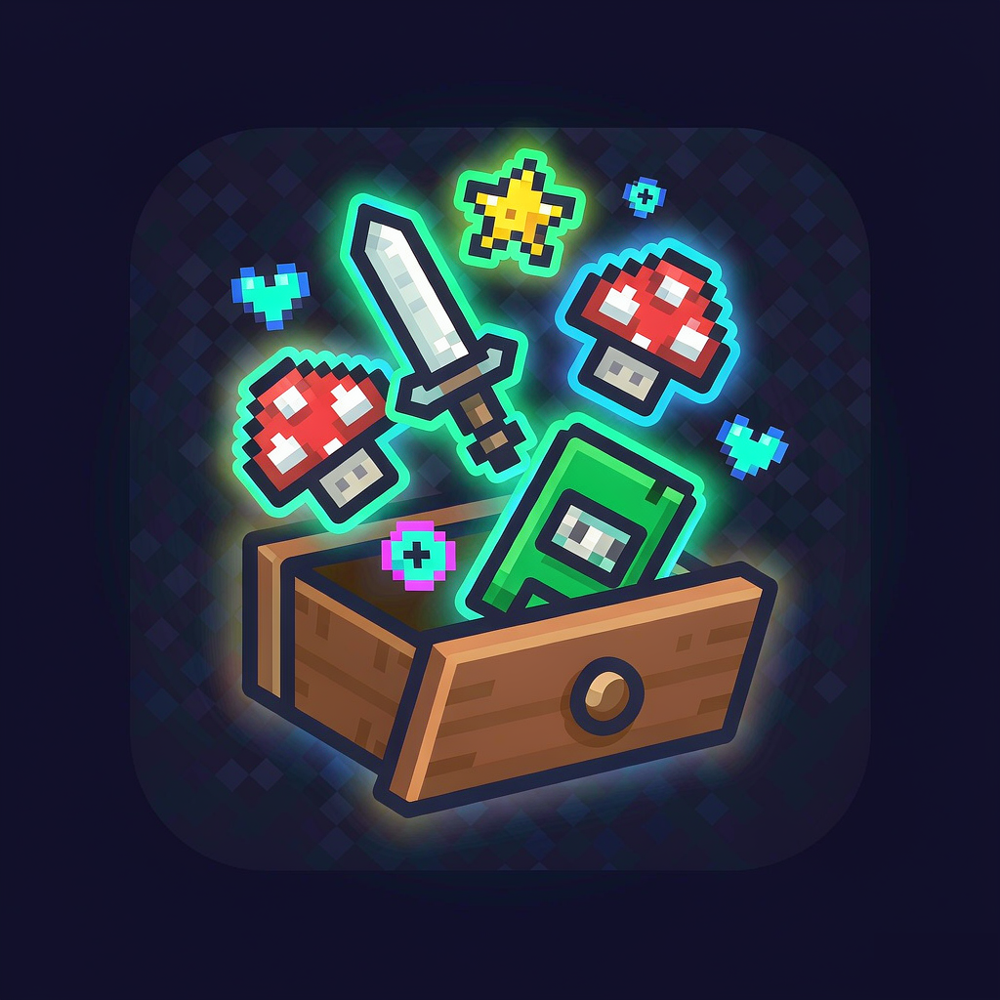

# 像素抽屉 · PixelShelf

**把 RPG Maker、Godot 与 Flash 的游戏装进 iPhone，离线运行。**


> **关于开发方式**：本仓库绝大部分代码由 AI 辅助生成，不是传统手工编写的产物。具体范围、人工介入的部分与验证方式见 [开发方式](#开发方式)。技术选型、产品判断、真机验证与合规结论由作者负责。

## 这是什么

像素抽屉是一个 **iOS 本地游戏播放器**。它不提供、不下载、不破解任何游戏内容，只做一件事：把你已经拥有的游戏包导入设备，识别它用的什么引擎，再用对应的运行时把它跑起来。

它不做硬件级模拟，而是按引擎分派到最合适的运行时——网页引擎交给 `WKWebView`，RGSS 交给原生 `mkxp-z`，Godot 与 Flash 交给各自的 WebAssembly 构建。所以包体小、启动快，也不需要越狱或 JIT。

|             |                                                              |
| ----------- | ------------------------------------------------------------ |
| **最近做的一件事** | 让一个 1.3 GB、单场景要吃掉 2 GB 内存的 RPG Maker MZ 游戏，在 iPhone 上不再被系统杀掉 |
| **最不擅长的事**  | 跑 Unity、Ren'Py、原生 App —— 这些引擎只能识别、不能运行                       |
| **永远不会做的事** | 联网、上传、内置游戏                                                   |

## 功能

### 游戏库

- 磁贴墙、分类筛选、标题搜索、封面裁切与重排
- 导入 `.apk` / `.zip` / `.xapk` / `.apks`，自动定位入口页面
- **支持设了密码的 zip**：ZipCrypto（传统）与 WinZip AES-128/256，导入时弹框输入，输错原地重试
- **自动跳过广告壳**：下载站常见的「更多游戏下载 / 安装说明 / 公众号」等外层目录会被排除，
  再往里按「有没有 RPG Maker 引擎脚本、有没有 index.html 与资源目录」打分，直接定位到真游戏那一层；
  只有分数接近（真的有两个平级游戏）时才把候选交给你选
- 从 APK 的 label 与图标提取游戏名和封面
- 引擎自动判定，可手动改
- 每个游戏的独立配置：画面适配、虚拟手柄布局、翻译字典、启动参数

### 运行时

- **RPG Maker MV / MZ**：`WKWebView` + 自定义 `rpg://` scheme，资源全部走本地
- **RPG Maker XP / VX / VX Ace**：原生 `mkxp-z`（arm64），带 Ruby 1.8 / 1.9 / 3.1 三套绑定
- **Godot 4**：内置 Godot web 导出运行时（4.5 / 4.6），游戏 PCK 在设备上重新打包
- **Flash**：内置 Ruffle，解析 SWF 头判断版本与压缩方式
- **其他网页工程**：`WKWebView` 直接跑，含多入口选择

### 输入

- 虚拟摇杆与面键，可拖拽布局、逐键调整大小与透明度
- 物理手柄映射（`GameController`），含震动反馈与输入自检
- RGSS 游戏的键位与手柄到手柄动作的映射表

### 存档与翻译

- 网页游戏的存档导出、导入与跨设备搬运
- 挂载游戏内已有的翻译文件，或导入外部 JSON（`MTool` 格式），同一时间只生效一份，重复导入覆盖

### 运行时增强

这一层是这个项目存在的主要原因——很多手机端跑不动的游戏，问题不在性能，而在内存。

| 机制                     | 解决什么                                                                       |
| ---------------------- | -------------------------------------------------------------------------- |
| **APNG 块级抽帧**          | 逐帧动画会一次性解出全部帧的 RGBA，几百帧就是几个 GB。在资源送达渲染层之前按预算抽帧，分辨率与总时长不变                   |
| **图片缓存回收**             | RPG Maker MZ 的 `ImageManager._cache` 只进不出，玩得越久吃得越多。超阈值时回收不在舞台上的位图，正在显示的图不动 |
| **WebAssembly 内存配额压制** | 部分引擎在 `WebAssembly.Memory` 里声明 2 GB 上限，iOS 会按这个数字计算网页进程额度。压到实际需要的值         |
| **启动看门狗**              | 启动卡死时打点各阶段，超时兜底并给出可读原因，而不是一直转圈                                             |
| **网络隔离**               | 资源全在本地，默认阻断一切对外请求。避免游戏内嵌的统计、广告与外链                                          |

### 其他

- 界面主题（色板、菱形底纹、通用组件）与浅色/深色适配
- 诊断日志落盘，出问题能定位到具体阶段
- 控制台面板：画面适配、布局、自检、重载、退出

## 支持的引擎

| 引擎                         | 运行时                    | 状态     |
| -------------------------- | ---------------------- | ------ |
| RPG Maker MV / MZ          | WKWebView              | ✅      |
| RPG Maker XP / VX / VX Ace | mkxp-z（原生 arm64）       | ✅      |
| Godot 4.x                  | Godot web export（wasm） | ✅      |
| Flash / SWF                | Ruffle（wasm）           | ✅      |
| 其他 HTML5 / 自研框架            | WKWebView              | ✅      |
| Ren'Py                     | —                      | ⚠️ 仅识别 |
| Unity                      | —                      | ⚠️ 仅识别 |
| 原生 App                     | —                      | ⚠️ 仅识别 |

## 环境要求

- iOS 17.0 或更高（真机）
- Xcode：已验证 Xcode 27.2 / iOS SDK 27.2
- macOS
- 不需要 CocoaPods / SPM 依赖，第三方运行时以资源包形式内置

## 构建

### 1. 应用本体

```bash
git clone https://github.com/inmchen-ctrl/PixelShelf.git && cd PixelShelf
open GameShelf.xcodeproj
```

> 仓库对外叫 PixelShelf，Xcode 工程、target 与产物名仍沿用内部代号 `GameShelf`，不影响使用。

在 **Signing & Capabilities** 里选自己的 Team，改掉 Bundle Identifier，然后选真机运行。

命令行构建（无签名，用于拿到 `.app`）：

```bash
xcodebuild -project GameShelf.xcodeproj -scheme GameShelf \
  -destination 'generic/platform=iOS' -configuration Release \
  CODE_SIGNING_ALLOWED=NO build
```

> 若遇到 `swift-plugin-server produced malformed response`，在构建参数里加  
> `OTHER_SWIFT_FLAGS='$(inherited) -disable-sandbox'`。

### 2. RGSS 引擎（可选）

仓库已包含预编译的 `Engine/mkxp-ios/core/lib/*.a`，直接编译即可。想自己重建：

```bash
sh Engine/mkxp-ios/build-mkxp-ios.sh core/lib
```

脚本会从公开仓库拉取 mkxp-z 的 Apple 移动端移植与预编译依赖，产出 `libmkxpz-core.a`  
与三份 Ruby 绑定，直接覆盖到工程实际链接的目录。细节见 [`Engine/mkxp-ios/README.md`](Engine/mkxp-ios/README.md)。

> **仓库不含 RPG Maker 的 RTP 素材。** `Engine/mkxp-ios/core/Assets.bundle/RTP`（约 187MB）的
> 版权属 KADOKAWA / Enterbrain，授权范围只覆盖「随 RPG Maker 游戏分发」，不适合放进公开仓库。
> 需要跑依赖 RTP 的 RGSS 游戏时，从自己的 RPG Maker 安装目录拷 `Graphics/` 与 `Audio/` 到该路径即可；
> 缺这层素材只影响「游戏本身没带图/音」的老工程，MV / MZ / Godot / Flash 完全不受影响。

## 架构

```
GameShelf/
├── Models/          数据模型（游戏记录、运行选项、自检报告）
├── Views/           界面层（游戏库、详情、播放器、设置、关于、手柄）
├── Core/
│   ├── GameStore           库索引、导入、目录管理
│   ├── PackageInspector    引擎判定、入口识别、多入口收集
│   ├── ZipReader           自写 zip 读取（无第三方依赖）
│   ├── GameSchemeHandler   rpg:// 资源服务，含 APNG 抽帧与注入
│   ├── GameWebView         WKWebView 容器、脚本注入、导航约束
│   ├── MkxpRuntime         RGSS 运行时桥接
│   ├── GodotRuntime        Godot wasm 运行时
│   ├── FlashRuntime        Ruffle 运行时
│   ├── ApngTrimmer         APNG 分块解析、抽帧、CRC 重算
│   ├── Gamepad / PhysicalGamepad  虚拟与物理手柄
│   └── AppSettings         设备级偏好
├── Resources/       内置运行时包与界面素材
└── Assets.xcassets  图标
Engine/mkxp-ios/     RGSS 引擎与构建脚本（GPL-2.0+，见许可）
```

`GameWebView.swift` 有三千多行，集中了*脚本*注入、启动看门狗、变量拦截、键位下发，  
是本项目最大也最需要重构的一个文件。

## 开发方式

**这个项目的绝大多数功能由 AI 辅助完成。** 之所以写在这里而不是藏在提交记录里，是因为使用者有权知道自己在依赖什么。

### AI 做了什么

| 范围      | 说明                                                    |
| ------- | ----------------------------------------------------- |
| 应用层代码   | 40 个 Swift 文件、约 1.4 万行，绝大部分由 AI 生成：界面、数据层、运行时桥接、格式解析  |
| 逆向与格式处理 | APNG 块结构、RPGMV 加密壳的密钥反推、APK 资源提取、zip 与 PCK 结构、SWF 头解析 |
| 问题定位    | 内存超限、无限转圈、黑屏、签名失败等问题的排查路径与验证脚本                        |
| 文档      | 本 README、第三方许可证清单、代码注释                                |

### 人做了什么

- **产品判断**：做成什么、不做什么；哪些游戏值得支持；什么时候该停手
- **技术选型与否决**：例如否掉「缩图换内存」方案，因为会破坏 RPG Maker 的画面比例
- **真机验证**：AI 无法替代的部分——手感、帧率、耗电、长时间挂机是否崩溃
- **法律与合规判断**：GPL 边界、分级、可分发范围
- **对 AI 输出的否决**：AI 给出的针对性 hack 被要求改成平台级方案，这类纠正发生过多次

### 这意味着什么

- **不要盲信代码质量**：AI 生成的部分经过编译与真机验证，但缺少系统性的单元测试与长期维护者的代码审查
- **不要假设注释准确**：部分注释是生成时写的，可能与后来的改动脱节
- **可以放心的是**：每一个影响运行的结论，都在真机上验证过，不是纸面推断

## 已知限制

- **不含任何游戏**。导入包的版权归各自权利人，请确认你拥有合法授权
- **不含 RPG Maker RTP 素材**。理由与补齐方式见[构建](#构建)一节；依赖 RTP 的老 RGSS 工程会缺图缺音
- **RAR 不支持**（含带密码的 RAR）。RAR 是私有格式，libarchive 只能识别「这个条目加密了」却不能解密，
  想真解压只能引入 UnRAR 源码，那套许可与本仓库的 MIT 声明冲突，暂不收录
- 加密 zip 只认 ZipCrypto 与 WinZip AES；7z、以及用「加密文件名」选项做出的包不支持
- **rgss 分支的许可是 GPL-3.0**（取决于是否启用 OpenSSL），完整包受其约束；仅使用其他引擎不涉及
- 不支持 JIT，Unity 与 Ren'Py 暂无运行方案
- 部分游戏依赖远程 CDN 资源，在默认的网络隔离下会加载失败（可在设置中放行）
- 没有单元测试，也没有 CI

## 反馈

- **开发者反馈群（QQ）**：`1135264591` —— 最快的方式，能贴日志就贴日志
- **邮件**：<inmchen@gmail.com>
- **Issue**：在本仓库提交，请带上 [`CONTRIBUTING.md`](CONTRIBUTING.md) 里列的复现信息

## 许可

应用层源码以 **MIT** 许可证发布，见 [`LICENSE`](LICENSE)。

分发包内含采用 copyleft 许可证的组件：

- `Engine/mkxp-ios`（mkxp-z，**GPL-2.0-or-later**；启用 OpenSSL 时产物按 **GPL-3.0** 处理）
- OpenAL Soft、FluidSynth（**LGPL**，静态链接）

因此**包含引擎的完整安装包整体受 GPL-3.0 约束**：对外分发时须同时提供对应源码。  
若只使用 MV/MZ/Godot/Flash 相关部分，则不涉及任何 copyleft 组件。

其余组件的许可证与归属见 [`THIRD_PARTY_NOTICES.md`](THIRD_PARTY_NOTICES.md)。

## 致谢

- [mkxp-z](https://github.com/mkxp-z/mkxp-z) 及其 Apple 移动端移植 [mkxp-z-apple-mobile](https://github.com/genexix05/mkxp-z-apple-mobile)
- [Godot Engine](https://github.com/godotengine/godot)
- [Ruffle](https://github.com/ruffle-rs/ruffle)
- 以及 SDL2、ANGLE、FreeType、OpenAL Soft、FluidSynth、pixman、PhysFS、OpenSSL 等依赖的维护者

## 免责声明

本项目只提供本地运行环境，不提供、不传播、不破解任何游戏内容。导入游戏的版权归各自权利人，  
使用者应自行确保拥有合法授权。因使用本项目产生的任何后果由使用者承担。

---

## English Summary

**PixelShelf**（像素抽屉）is a local game player for iOS. It imports the game packages you already own  
(`.apk` / `.zip`) and runs them with the right runtime per engine: `WKWebView` for RPG Maker  
MV/MZ and generic HTML5 games, native `mkxp-z` for RGSS (XP/VX/VX Ace), Godot's web export and  
Ruffle for Flash. Nothing is downloaded, uploaded or bundled — network access is blocked by  
default.

It also carries a runtime mitigation layer for memory-bound games: APNG frame thinning at the  
block level, incremental image-cache reclamation for RPG Maker MZ, and a cap on the  
`WebAssembly.Memory` limit that engines tend to over-declare.

Requires iOS 17+ and Xcode. `MIT` licensed, except the bundled `mkxp-z` engine (`GPL`) — see  
[`LICENSE`](LICENSE) and [`THIRD_PARTY_NOTICES.md`](THIRD_PARTY_NOTICES.md).

**Most of the code in this repository was written with AI assistance.** See  
[开发方式](#开发方式) for the exact scope, what was human-decided, and how it was verified.
